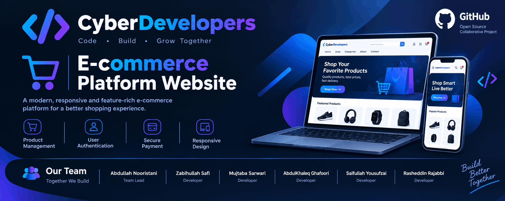

# CyberDevelopers — Froshgah E-Commerce Platform 🛒
## Active leading and developing: Eng. Abdullah Nooristani

### Semester 5 Team Project | Advanced Software Engineering

<p align="center">
  
</p>

<p align="center">
  A collaborative PHP and MySQL-based e-commerce platform developed by the CyberDevelopers team.
</p>

<p align="center">
  
  
  
  
  
  
</p>

---

## 📖 Table of Contents

1. [Introduction](#-introduction)
2. [Project Overview](#-project-overview)
3. [Team CyberDevelopers](#-team-cyberdevelopers)
4. [Technologies](#-technologies)
5. [Features](#-features)
6. [Project Architecture](#-project-architecture)
7. [Project Structure](#-project-structure)
8. [System Requirements](#-system-requirements)
9. [Installation and Setup](#-installation-and-setup)
10. [Database Configuration](#-database-configuration)
11. [Running the Application](#-running-the-application)
12. [Git Development Workflow](#-git-development-workflow)
13. [Contributing](#-contributing)
14. [Security Considerations](#-security-considerations)
15. [Academic Purpose](#-academic-purpose)
16. [Future Improvements](#-future-improvements)
17. [License](#-license)
18. [Acknowledgements](#-acknowledgements)

---

## 🚀 Introduction

**Froshgah** is a web-based e-commerce platform developed by **CyberDevelopers** as a Semester 5 team project for the Advanced Software Engineering course.

The project demonstrates the practical application of software engineering principles and modern web development technologies in building an online shopping system.

Our goal is to develop a structured, user-friendly, and maintainable e-commerce platform that connects customers with products through an organized digital shopping experience.

The project covers important aspects of software development, including:

- Frontend and backend development.
- Relational database design and management.
- User authentication and authorization.
- E-commerce functionality.
- Administrative management.
- Team collaboration and version control.
- Software development lifecycle practices.

## 🎯 Project Overview

| Attribute | Description |
|---|---|
| Project Name | Froshgah |
| Team Name | CyberDevelopers |
| Project Type | E-Commerce Web Application |
| Academic Semester | Semester 5 |
| Course | Advanced Software Engineering |
| Backend | PHP |
| Database | MySQL |
| Frontend | HTML, CSS, JavaScript |
| Version Control | Git and GitHub |
| Repository | [GitHub Repository](https://github.com/abdullahnooristani332/froshgah) |

## 👥 Team CyberDevelopers

This project is developed collaboratively by six team members.

| No. | Team Member | Responsibility |
|---|---|---|
| 1 | **Abdullah Nooristani** | Team Lead |
| 2 | Zabihullah Safi | Developer |
| 3 | Mujtaba Sarwari | Developer |
| 4 | AbdulKhaleq Ghafoori | Developer |
| 5 | Saifullah Yousufzai | Developer |
| 6 | Rasheddin Rajabbi | Developer |

**Team Name:** CyberDevelopers

**Collaboration:** Software design, development, implementation, testing, and documentation.

## 🛠 Technologies

The project uses the following technologies:

| Technology | Application |
|---|---|
| PHP | Server-side programming and business logic |
| MySQL | Database management |
| HTML5 | Web page structure |
| CSS3 | Interface styling and responsive design |
| JavaScript | Client-side interaction |
| PDO | Secure database connectivity |
| Apache | Web server |
| Git | Version control |
| GitHub | Source code hosting and collaboration |
| Laragon / XAMPP | Local development environment |

## ✨ Features

### Customer Module

- User registration and login.
- Product browsing.
- Product details.
- Shopping cart.
- Order placement and management.
- Customer profile management.
- Order history.
- Product reviews.
- Notifications.

### Administrator Module

- Administrative dashboard.
- Product management.
- Order management.
- User management.
- Administrative operations.

*Feature availability depends on the implemented functionality in the current source code.*

## 🏗 Project Architecture

Froshgah follows a structured PHP web application approach, separating different application responsibilities into dedicated directories.

The general request flow is:

```text
              USER / BROWSER
                    |
                    v
             PRESENTATION
          HTML / CSS / JavaScript
                    |
                    v
             PHP APPLICATION
          Pages / Actions / Includes
                    |
                    v
              DATA ACCESS
                  PDO
                    |
                    v
               MySQL DB
```

### Main Application Responsibilities

| Layer | Responsibility |
|---|---|
| Presentation Layer | Displays the user interface |
| Application Layer | Processes requests and business logic |
| Data Access Layer | Communicates with the database |
| Database Layer | Stores application information |

## 📂 Project Structure

The main project directories are organized as follows:

```text
froshgah/
│
├── actions/          # Request processing and application actions
│
├── admin/            # Administrative dashboard and operations
│
├── assets/           # CSS, JavaScript, images and static resources
│
├── config/           # Application and database configuration
│
├── database/         # Database scripts and SQL exports
│
├── includes/         # Shared PHP components and reusable files
│
├── pages/            # Customer-facing application pages
│
├── uploads/          # Uploaded product images and other files
│
├── index.php         # Main application entry point
├── logout.php        # User logout functionality
├── projectImage.png  # Project presentation image
├── README.md         # Project documentation
└── .gitignore        # Git exclusion rules
```

## 💻 System Requirements

Before installing the project, make sure your system has:

| Requirement | Recommended Version |
|---|---|
| Operating System | Windows, Linux or macOS |
| PHP | 8.0 or later |
| MySQL | 5.7 or later |
| Apache | 2.4 or later |
| Git | Latest stable version |
| Browser | Chrome, Firefox, Edge or equivalent |
| PHP Extensions | PDO and PDO MySQL |

**Recommended environment:** Laragon or XAMPP.

## ⚙️ Installation and Setup

Follow these instructions to download and run Froshgah on your local computer.

### Step 1: Install the Required Software

Install the following:

- [PHP / Laragon](https://laragon.org/download/)
- [Git](https://git-scm.com/downloads)
- [Visual Studio Code](https://code.visualstudio.com/)
- [MySQL / phpMyAdmin](https://www.phpmyadmin.net/)

If you use Laragon, PHP, MySQL, Apache, and phpMyAdmin can be managed through its local development environment.

### Step 2: Clone the Repository

Open CMD, PowerShell, Git Bash, or the VS Code terminal.

For Laragon:

```bash
cd C:\laragon\www
```

For XAMPP:

```bash
cd C:\xampp\htdocs
```

Clone the repository:

```bash
git clone https://github.com/abdullahnooristani332/froshgah.git
```

Enter the project directory:

```bash
cd froshgah
```

### Step 3: Start Apache and MySQL

**For Laragon:**

1. Open Laragon.
2. Click Start All.
3. Ensure Apache and MySQL are running.

**For XAMPP:**

1. Open XAMPP Control Panel.
2. Start Apache.
3. Start MySQL.

### Step 4: Create the MySQL Database

Open phpMyAdmin:

```text
http://localhost/phpmyadmin
```

1. Create a new database.
2. Use the database name specified in your project configuration, or choose a name and configure the application accordingly.
3. Open the project's `database/` directory.
4. Locate the provided SQL schema or database export.
5. Select your database in phpMyAdmin.
6. Open the Import tab.
7. Choose the SQL file.
8. Click Import.

If no SQL file is included, obtain the database schema from the project maintainer before continuing.

### Step 5: Configure Database Credentials

Open the `config/` directory and locate the existing database connection file.

Configure your local database credentials.

Example PDO connection:

```php
<?php

$host = 'localhost';
$dbname = 'froshgah_db';
$username = 'root';
$password = '';

$dsn = "mysql:host=$host;dbname=$dbname;charset=utf8mb4";

$pdo = new PDO($dsn, $username, $password);

$pdo->setAttribute(
    PDO::ATTR_ERRMODE,
    PDO::ERRMODE_EXCEPTION
);
```

**Important:** This is an example. Follow the existing connection structure in the project rather than replacing your actual configuration blindly.

Never upload production credentials or private passwords to GitHub.

### Step 6: Run Froshgah

Open your browser:

```text
http://localhost/froshgah/
```

If the installation is successful, the Froshgah homepage should load.

---

## 🗄 Database Configuration

Froshgah uses MySQL as its relational database management system.

The database stores information required for the application's operations, such as:

- User accounts.
- Products.
- Shopping carts.
- Orders.
- Reviews.
- Notifications.

The database schema and SQL initialization files should be maintained inside the `database/` directory.

Before importing any database backup, make sure it does not contain real customer information, passwords, or other sensitive records.

## ▶ Running the Application

After completing the installation:

1. Start Apache.
2. Start MySQL.
3. Ensure the database exists.
4. Check database credentials.
5. Open the application in your browser.

```text
http://localhost/froshgah/
```

For local development, use your Laragon or XAMPP environment.

## 🌿 Git Development Workflow

Developers who want to contribute should follow a branch-based Git workflow.

### 1. Clone the Repository

```bash
git clone https://github.com/abdullahnooristani332/froshgah.git
```

### 2. Enter the Project

```bash
cd froshgah
```

### 3. Create a Feature Branch

```bash
git checkout -b feature/your-feature-name
```

### 4. Make Your Changes

Modify the project files and test your implementation.

### 5. Stage Your Changes

```bash
git add .
```

### 6. Commit Your Changes

```bash
git commit -m "Add your feature description"
```

### 7. Push Your Branch

```bash
git push -u origin feature/your-feature-name
```

### 8. Create a Pull Request

Open the repository on GitHub and create a Pull Request to propose merging your changes into the main branch.

## 🤝 Contributing

We welcome contributions, suggestions, bug reports, and improvements.

To contribute:

1. Fork the repository.
2. Clone your fork.
3. Create a separate feature branch.
4. Implement your changes.
5. Test your changes.
6. Commit and push your work.
7. Submit a Pull Request.

Please keep your code organized and provide clear descriptions of your contributions.

## 🔐 Security Considerations

Security is an important part of web application development.

Please follow these practices:

- Never upload database passwords or API keys.
- Use prepared statements for database operations.
- Validate and sanitize user input.
- Hash passwords using secure password hashing functions.
- Implement authentication and authorization checks.
- Restrict access to administrative functionality.
- Validate uploaded files.
- Avoid exposing sensitive error messages.
- Keep private user data out of public repositories.

## 🎓 Academic Purpose

This project is developed as part of the Semester 5 Advanced Software Engineering course.

It demonstrates the practical application of software engineering concepts, collaborative development, database integration, web technologies, and project documentation.

The project is intended for educational purposes and can be extended as a foundation for further software engineering development.

## 🚀 Future Improvements

Potential improvements include:

- Online payment gateway integration.
- Advanced product search and filtering.
- Product recommendation system.
- Enhanced analytics dashboard.
- Email notifications.
- Improved security and performance.
- REST API development.
- Automated testing.
- Deployment to a production server.

These are possible future enhancements and should not be interpreted as currently implemented features.

## 📜 License

No open-source license has currently been specified.

Unless the project owner adds a license, the source code remains subject to applicable copyright law. Please contact the project owner for permission before redistributing or reusing the code.

## 🙏 Acknowledgements

We would like to thank our instructors, classmates, and everyone who supported the development of this project.

Special thanks to all members of **CyberDevelopers** for their collaboration, dedication, and contributions.

---

<p align="center">
  <strong>CyberDevelopers</strong>
  <br>
  Building Ideas Into Software.
  <br><br>
  ⭐ If you find this project interesting, consider giving it a star on GitHub!
</p>

<p align="center">
  <a href="https://github.com/abdullahnooristani332/froshgah">GitHub Repository</a>
</p>
